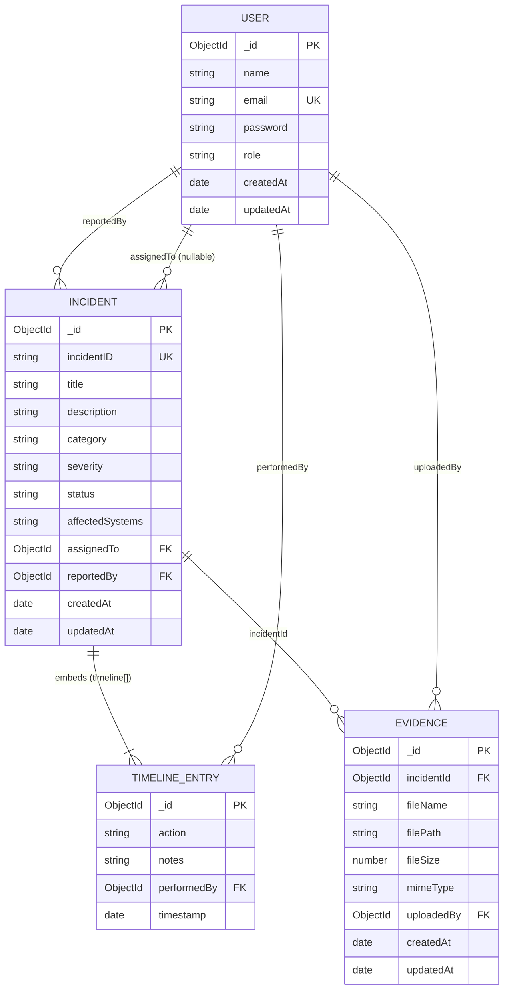

# CyberShield — Cybersecurity Incident Management Platform
## Project Review Report
> Generated from full static analysis of all source files. No details are invented — anything unavailable is labelled **NOT FOUND**.

---

## 1. Project Overview

- **Project Name:** CyberShield — Cybersecurity Incident Management Platform
- **One-line Purpose:** A web application for logging, tracking, and resolving cybersecurity incidents.
- **Description:** CyberShield is a full-stack MERN (MongoDB, Express, React, Node.js) platform that allows security teams to report, triage, assign, and resolve security incidents. Each incident has a full audit timeline, analyst assignment, and a forensic evidence file upload system. The platform enforces JWT-based authentication with two distinct user roles.
- **Target Users:** Security Operations Center (SOC) teams — specifically Admins and Security Analysts.

**Actors / Roles (from `User.js` model):**
| Role | Description |
|------|-------------|
| `Admin` | Full platform access; can assign incidents, change status, add notes, upload evidence |
| `Analyst` | Same functional access as Admin at the API level (no route-level role restriction on incident operations); distinguishable via UI display |

> **Note:** The `adminOnly` middleware exists in `authMiddleware.js` but is **not wired to any route** in the current codebase. All protected routes use only `protect` (auth check), meaning both Admin and Analyst have identical API access.

---

## 2. Requirements (Inferred from Code)

### Functional Requirements

| # | Feature | Status |
|---|---------|--------|
| 1 | User Registration (name, email, password, role) | ✅ Implemented |
| 2 | User Login with JWT | ✅ Implemented |
| 3 | Auth token verification on mount (`/auth/me`) | ✅ Implemented |
| 4 | Logout (clears localStorage) | ✅ Implemented |
| 5 | Create security incident (title, desc, category, severity, systems, assignee) | ✅ Implemented |
| 6 | List all incidents | ✅ Implemented |
| 7 | View incident details with full timeline | ✅ Implemented |
| 8 | Update incident status with note (New → In Progress → Mitigated → Resolved) | ✅ Implemented |
| 9 | Reassign incident to any user | ✅ Implemented |
| 10 | Add analyst notes to incident timeline | ✅ Implemented |
| 11 | Upload forensic evidence files (attached to incident) | ✅ Implemented |
| 12 | Download/view evidence files | ✅ Implemented |
| 13 | Client-side search by ID, title, affected systems, description | ✅ Implemented |
| 14 | Client-side filter by category, severity, status | ✅ Implemented |
| 15 | Dashboard stat cards (total, critical open, unassigned, in-progress) | ✅ Implemented |
| 16 | Auto-generated incremental Incident ID (INC-1001, INC-1002…) | ✅ Implemented |
| 17 | Audit trail — every status change, assignment, evidence upload, note logged | ✅ Implemented |
| 18 | Health check endpoint | ✅ Implemented |
| 19 | Role-based route restriction (Admin only) | ⚠️ Middleware exists, **not applied to any route** |
| 20 | Notifications (email, in-app) | ❌ NOT FOUND |
| 21 | Pagination (server-side) | ❌ NOT FOUND |
| 22 | Sorting (server-side) | ❌ NOT FOUND (client fetches all, sorts by `createdAt: -1`) |
| 23 | Delete incident | ❌ NOT FOUND |
| 24 | Edit incident fields after creation | ❌ NOT FOUND |
| 25 | Admin panel / user management | ❌ NOT FOUND |
| 26 | Password change / reset | ❌ NOT FOUND |

### Non-Functional Requirements

**Security measures actually in use:**
- **JWT (`jsonwebtoken` ^9.0.2):** Tokens issued on login/register, expire in 7 days, verified via `protect` middleware on every protected route
- **bcrypt (`bcryptjs` ^2.4.3):** Passwords hashed with salt rounds = 10 via Mongoose `pre('save')` hook; `select: false` on password field prevents accidental exposure
- **CORS:** Configured to allow only `CLIENT_URL` (default `http://localhost:5173`) with `credentials: true`
- **Global 401 handler (frontend):** Axios response interceptor auto-redirects to `/login` on any 401 response and clears localStorage
- **File type whitelist (Multer):** Only `.log, .pcap, .png, .jpg, .jpeg, .pdf, .txt` allowed; 10MB size limit enforced

**Security measures NOT present:**
- No `helmet` (HTTP security headers)
- No rate limiting (e.g., `express-rate-limit`)
- No input sanitisation library (e.g., `express-validator`, `joi`)
- No CSRF protection
- JWT secret is a plain string in `.env` (no rotation mechanism)

**Performance:**
- No database indexes defined explicitly in Mongoose schemas (only the implicit `_id` index and the `unique: true` index on `User.email` and `Incident.incidentID`)
- No server-side pagination — all incidents are fetched in a single query
- No caching layer (Redis, etc.)

**Responsiveness:**
- Tailwind CSS responsive grid breakpoints used (`sm:`, `md:`, `lg:`) in all pages
- Fixed sidebar with `ml-64` main content offset — mobile layout not tested/handled

---

## 3. Architecture

### Folder Structure

```
cyber-incident-platform/
├── docker-compose.yml          # MongoDB only
├── backend/
│   ├── server.js               # Express entry point
│   ├── .env                    # Environment variables
│   ├── seed.js                 # Database seeder
│   ├── config/
│   │   └── db.js               # Mongoose connection
│   ├── models/
│   │   ├── User.js
│   │   ├── Incident.js
│   │   └── Evidence.js
│   ├── controllers/
│   │   ├── authController.js
│   │   ├── incidentController.js
│   │   └── evidenceController.js
│   ├── routes/
│   │   ├── authRoutes.js
│   │   ├── incidentRoutes.js
│   │   └── evidenceRoutes.js
│   ├── middleware/
│   │   ├── authMiddleware.js
│   │   └── uploadMiddleware.js
│   └── uploads/                # Local disk storage for evidence files
└── frontend/
    ├── .env                    # VITE_API_URL
    ├── package.json
    ├── tailwind.config.js
    └── src/
        ├── main.jsx
        ├── App.jsx             # Router definition
        ├── index.css           # Tailwind + custom design system
        ├── context/
        │   └── AuthContext.jsx
        ├── components/
        │   ├── Layout.jsx
        │   ├── Sidebar.jsx
        │   ├── ProtectedRoute.jsx
        │   └── utils.js
        ├── pages/
        │   ├── LoginPage.jsx
        │   ├── RegisterPage.jsx
        │   ├── DashboardPage.jsx
        │   ├── IncidentsListPage.jsx
        │   ├── CreateIncidentPage.jsx
        │   └── IncidentDetailsPage.jsx
        └── services/
            └── api.js          # Axios instance with interceptors
```

### Layer Connectivity

```
Browser (React / Vite :5173)
    │  Axios (baseURL: http://localhost:5000/api)
    │  Authorization: Bearer <JWT> header on every request
    ▼
Express API (:5000)
    │  CORS → express.json() → express.urlencoded() → static /uploads
    │  Routes: /api/auth, /api/incidents, /api/incidents/:id/evidence
    │  protect middleware (JWT verify) → controllers
    ▼
MongoDB (:27017)  [Docker container: cyber-incident-mongodb]
    Collections: users, incidents, evidences
```

**External APIs / Services / SDKs:** NONE found. No email, cloud storage, payment, maps, or AI integrations.

**Deployment Config:**
- `docker-compose.yml` — MongoDB only (no backend or frontend containerised)
- No `Dockerfile`, `vercel.json`, `render.yaml`, or any other deployment config found

### Express Middleware Chain (in order, from `server.js`)

1. `cors({ origin: CLIENT_URL, credentials: true })` — allow cross-origin from frontend
2. `express.json()` — parse JSON request bodies
3. `express.urlencoded({ extended: true })` — parse form-encoded bodies
4. `express.static('/uploads')` — serve evidence files publicly
5. Route-level: `protect` (JWT verification) — applied via `router.use(protect)` on incident/evidence routers, and per-route on auth
6. Route-level: `upload.single('file')` (Multer) — applied only to `POST /api/incidents/:id/evidence`
7. Global 404 handler
8. Global error handler (returns `{ message }` JSON)

> **Note:** `adminOnly` middleware is defined but not mounted anywhere in the chain.

---

## 4. Use Cases

### Actor: Any Authenticated User (Admin or Analyst — same API access)

| # | Use Case | Route / Page |
|---|----------|-------------|
| UC-1 | Log In | `POST /api/auth/login` → `LoginPage` |
| UC-2 | Register Account | `POST /api/auth/register` → `RegisterPage` |
| UC-3 | View Security Dashboard | `GET /api/incidents` → `DashboardPage` |
| UC-4 | View All Incidents (with filter/search) | `GET /api/incidents` → `IncidentsListPage` |
| UC-5 | Create New Incident | `POST /api/incidents` → `CreateIncidentPage` |
| UC-6 | View Incident Details & Timeline | `GET /api/incidents/:id` → `IncidentDetailsPage` |
| UC-7 | Change Incident Status | `PATCH /api/incidents/:id/status` → `IncidentDetailsPage` (status bar) |
| UC-8 | Reassign Incident to Analyst | `PATCH /api/incidents/:id/assign` → `IncidentDetailsPage` (assignee dropdown) |
| UC-9 | Add Timeline Note | `POST /api/incidents/:id/notes` → `IncidentDetailsPage` (note form) |
| UC-10 | Upload Forensic Evidence | `POST /api/incidents/:id/evidence` → `IncidentDetailsPage` (evidence panel) |
| UC-11 | Download/View Evidence File | `GET /uploads/<filename>` → `IncidentDetailsPage` (download link) |
| UC-12 | Log Out | (localStorage clear) → `Sidebar` |
| UC-13 | Get Analyst List for Dropdown | `GET /api/auth/analysts` → `CreateIncidentPage`, `IncidentDetailsPage` |

**Include/Extend Relationships:**
- UC-5 **includes** UC-13 (fetches analyst list for assignment dropdown)
- UC-6 **includes** UC-13 (fetches analyst list for reassignment)
- UC-7 **extends** UC-6 (status change from within incident detail view); includes optional timeline note
- UC-8 **extends** UC-6 (reassignment from within incident detail view)
- UC-9 **extends** UC-6 (note submission from within incident detail view)
- UC-10 **extends** UC-6 (file upload auto-appends to incident timeline)

### Actor: Admin (theoretically distinct, but no enforced difference at API level)

- `adminOnly` middleware exists in `authMiddleware.js` but is not applied to any route.
- No admin-only pages exist in the frontend.
- In practice: **Admin and Analyst have identical system access.**

---

## 5. Database / ER Design

### Collections & Schemas

#### `users` (User.js)
| Field | Type | Required | Unique | Default | Notes |
|-------|------|----------|--------|---------|-------|
| `_id` | ObjectId | auto | yes | — | Mongoose default |
| `name` | String | yes | no | — | trimmed |
| `email` | String | yes | yes | — | lowercased, trimmed |
| `password` | String | yes | no | — | min 6 chars; `select: false`; bcrypt hashed pre-save |
| `role` | String (enum) | no | no | `'Analyst'` | enum: `['Analyst', 'Admin']` |
| `createdAt` | Date | auto | no | — | timestamps: true |
| `updatedAt` | Date | auto | no | — | timestamps: true |

#### `incidents` (Incident.js)
| Field | Type | Required | Unique | Default | Notes |
|-------|------|----------|--------|---------|-------|
| `_id` | ObjectId | auto | yes | — | |
| `incidentID` | String | no | yes | auto-gen | Pre-save hook: `INC-${1001 + count}` |
| `title` | String | yes | no | — | trimmed |
| `description` | String | yes | no | — | |
| `category` | String (enum) | yes | no | — | `['Malware','Phishing','Data Leak','Unauthorized Access']` |
| `severity` | String (enum) | yes | no | — | `['Low','Medium','High','Critical']` |
| `status` | String (enum) | no | no | `'New'` | `['New','In Progress','Mitigated','Resolved']` |
| `affectedSystems` | String | no | no | `''` | |
| `assignedTo` | ObjectId (ref: User) | no | no | `null` | |
| `reportedBy` | ObjectId (ref: User) | yes | no | — | Set to `req.user._id` on create |
| `timeline` | [timelineEntrySchema] | no | no | auto-init | See embedded schema below |
| `createdAt` | Date | auto | no | — | timestamps: true |
| `updatedAt` | Date | auto | no | — | timestamps: true |

**Embedded: `timelineEntry`** (within `incidents.timeline[]`)
| Field | Type | Required | Default |
|-------|------|----------|---------|
| `_id` | ObjectId | auto | — |
| `action` | String | yes | — |
| `notes` | String | no | `''` |
| `performedBy` | ObjectId (ref: User) | yes | — |
| `timestamp` | Date | no | `Date.now` |

#### `evidences` (Evidence.js)
| Field | Type | Required | Unique | Default | Notes |
|-------|------|----------|--------|---------|-------|
| `_id` | ObjectId | auto | yes | — | |
| `incidentId` | ObjectId (ref: Incident) | yes | no | — | |
| `fileName` | String | yes | no | — | Original filename |
| `filePath` | String | yes | no | — | Disk path on server |
| `fileSize` | Number | yes | no | — | Bytes |
| `mimeType` | String | no | no | `''` | |
| `uploadedBy` | ObjectId (ref: User) | yes | no | — | |
| `createdAt` | Date | auto | no | — | timestamps: true |
| `updatedAt` | Date | auto | no | — | timestamps: true |

### Relationships

| From | To | Field | Type | Cardinality |
|------|----|-------|------|-------------|
| Incident | User | `reportedBy` | ref (ObjectId) | N:1 |
| Incident | User | `assignedTo` | ref (ObjectId), nullable | N:1 |
| Incident | User | `timeline[].performedBy` | ref (ObjectId) | N:1 (per entry) |
| Evidence | Incident | `incidentId` | ref (ObjectId) | N:1 |
| Evidence | User | `uploadedBy` | ref (ObjectId) | N:1 |
| Incident | timelineEntry | `timeline` | **embedded array** | 1:N |

### Indexes Explicitly Defined

- `User.email` — unique index (from `unique: true`)
- `Incident.incidentID` — unique index (from `unique: true`)
- No compound indexes, no `index: true` fields, no `Schema.index()` calls

### Seed Script (`seed.js`)

Seeds:
- **2 users:** Alice Morgan (Admin, `admin@cyberplatform.io`), Bob Chen (Analyst, `analyst@cyberplatform.io`)
- **3 incidents** with pre-populated timeline entries

### ER Diagram (Mermaid)



---

## 6. Modules

| Module | Description | Key Functions | Main Files |
|--------|-------------|---------------|------------|
| **Auth** | User registration, login, JWT issuance, token verification | `registerUser`, `loginUser`, `getMe`, `getAllAnalysts`, `protect`, `adminOnly` | `authController.js`, `authRoutes.js`, `authMiddleware.js`, `AuthContext.jsx`, `LoginPage.jsx`, `RegisterPage.jsx` |
| **Incidents** | Full CRUD lifecycle for security incidents | `createIncident`, `getIncidents`, `getIncidentById`, `updateIncidentStatus`, `assignIncident`, `addTimelineNote` | `incidentController.js`, `incidentRoutes.js`, `Incident.js`, `DashboardPage.jsx`, `IncidentsListPage.jsx`, `CreateIncidentPage.jsx`, `IncidentDetailsPage.jsx` |
| **Evidence** | File upload and retrieval for forensic evidence | `uploadEvidence`, `getEvidenceByIncident` | `evidenceController.js`, `evidenceRoutes.js`, `Evidence.js`, `uploadMiddleware.js`, `IncidentDetailsPage.jsx` |
| **Database** | MongoDB connection management | `connectDB` | `config/db.js` |
| **API Client** | Axios instance with auth interceptors and 401 redirect | request/response interceptors | `services/api.js` |
| **UI Shell** | App layout, sidebar navigation, protected routes | `Layout`, `Sidebar`, `ProtectedRoute` | `Layout.jsx`, `Sidebar.jsx`, `ProtectedRoute.jsx`, `App.jsx` |
| **Utilities** | Badge formatters and date/size formatters | `getSeverityBadge`, `getStatusBadge`, `formatDate`, `formatFileSize` | `components/utils.js` |

---

## 7. Tech Stack (Exact)

### Backend Dependencies (`backend/package.json`)

| Package | Version | Category |
|---------|---------|----------|
| `express` | ^4.19.2 | Web framework |
| `mongoose` | ^8.4.1 | MongoDB ODM |
| `dotenv` | ^16.4.5 | Env config |
| `cors` | ^2.8.5 | CORS middleware |
| `multer` | ^1.4.5-lts.1 | File upload |
| `jsonwebtoken` | ^9.0.2 | JWT (auth) |
| `bcryptjs` | ^2.4.3 | Password hashing (auth/security) |
| `nodemon` | ^3.1.4 (dev) | Dev auto-restart |

### Frontend Dependencies (`frontend/package.json`)

| Package | Version | Category |
|---------|---------|----------|
| `react` | ^18.3.1 | UI framework |
| `react-dom` | ^18.3.1 | React DOM |
| `react-router-dom` | ^6.24.0 | Client-side routing |
| `axios` | ^1.7.2 | HTTP client |
| `lucide-react` | ^0.395.0 | Icon library |
| `tailwindcss` | ^3.4.4 (dev) | CSS utility framework |
| `vite` | ^5.3.1 (dev) | Build tool / dev server |
| `@vitejs/plugin-react` | ^4.3.1 (dev) | Vite React plugin |
| `autoprefixer` | ^10.4.19 (dev) | PostCSS autoprefixer |
| `postcss` | ^8.4.39 (dev) | PostCSS |
| `@types/react` | ^18.3.3 (dev) | TypeScript types |
| `@types/react-dom` | ^18.3.0 (dev) | TypeScript types |

### Runtime & Database

| Item | Value |
|------|-------|
| Node.js | v24.19.0 (installed via winget during this session) |
| Database | MongoDB (local via Docker: `mongo:latest`) |
| DB connection | `mongodb://localhost:27017/cyber-incident-platform` (local, not Atlas) |

### Testing & Docs

- **Testing:** NOT FOUND (no test framework, no test files)
- **API Docs:** NOT FOUND (no Swagger, no Postman collection)
- **Logging:** `console.log` / `console.error` only (no structured logging library)

---

## 8. Frontend

### Pages / Routes (React Router v6, defined in `App.jsx`)

| Path | Component | Protected | Notes |
|------|-----------|-----------|-------|
| `/login` | `LoginPage` | No | Shows demo credentials on the form |
| `/register` | `RegisterPage` | No | |
| `/dashboard` | `DashboardPage` | Yes | Stat cards + recent 8 incidents table |
| `/incidents` | `IncidentsListPage` | Yes | Full table with search + 3 filter dropdowns |
| `/incidents/new` | `CreateIncidentPage` | Yes | Form to create new incident |
| `/incidents/:id` | `IncidentDetailsPage` | Yes | Full detail: status, timeline, evidence |
| `/` | Redirect → `/dashboard` | — | |
| `*` | Redirect → `/dashboard` | — | Catch-all |

### Reusable Components

| Component | Purpose |
|-----------|---------|
| `Layout` | Wraps Sidebar + main content area |
| `Sidebar` | Fixed left nav with logo, nav links, user info, logout |
| `ProtectedRoute` | Renders loading spinner → redirects to `/login` if no auth |
| `StatCard` | Inline component in `DashboardPage` — metric card with icon |

### State Management

- **Approach:** React Context API (`AuthContext`)
- **What is stored in context:** `user` object (id, name, email, role), `loading` boolean, `login`, `register`, `logout` functions
- **Token storage:** `localStorage` (`'token'` key for raw JWT, `'user'` key for serialised user object)
- **Page-level state:** Each page manages its own local state via `useState` (incidents array, loading, error, filter values, form values, modal state)

### Styling

- **Framework:** Tailwind CSS v3.4.4
- **UI Library:** `lucide-react` v0.395.0 (icons only)
- **Design System:** Custom token layer defined in `tailwind.config.js` (referenced but not read — tokens like `cyber-bg`, `cyber-card`, `cyber-accent`, `cyber-border`, `cyber-muted`, `cyber-text`, `cyber-text-dim`, `cyber-danger`)
- **Component classes:** Custom `@layer components` classes in `index.css`: `.card`, `.card-sm`, `.btn-primary`, `.btn-secondary`, `.btn-danger`, `.btn-ghost`, `.input`, `.label`, `.select`, `.badge-*` (8 variants), `.nav-link`, `.table-row`, `.glow-accent`, `.glow-danger`
- **Animations:** `animate-fade-in` (fadeIn 0.3s), `animate-slide-up` (slideUp 0.3s), `.spinner` (spin 0.7s)
- **Design tool / Wireframes:** NOT FOUND

### API Calling Pattern

- **Instance:** `axios.create` with `baseURL: VITE_API_URL` (default `http://localhost:5000/api`)
- **Request interceptor:** Reads `token` from `localStorage`, injects `Authorization: Bearer <token>` header
- **Response interceptor:** On any 401, clears localStorage and redirects to `/login` via `window.location.href`
- **Usage pattern:** `const { data } = await api.get/post/patch(...)` directly in component `useEffect` or event handlers — no custom hooks layer

### Protected / Role-Based Route Handling

- `ProtectedRoute` wraps all non-auth routes; shows spinner while `loading`, redirects to `/login` (with `state.from` preserved) if `!user`
- **Role-based routing in the frontend:** NOT IMPLEMENTED — no route or UI element is gated by role

---

## 9. Backend

### Folder Structure

```
backend/
├── server.js           # Express app setup + route mounting
├── seed.js             # One-shot DB seeder
├── .env                # Env config
├── config/
│   └── db.js           # mongoose.connect()
├── models/
│   ├── User.js         # Schema + bcrypt hooks
│   ├── Incident.js     # Schema + auto-ID pre-save hook
│   └── Evidence.js     # Schema
├── controllers/
│   ├── authController.js       # register, login, getMe, getAllAnalysts
│   ├── incidentController.js   # 6 functions
│   └── evidenceController.js   # upload, get
├── routes/
│   ├── authRoutes.js
│   ├── incidentRoutes.js
│   └── evidenceRoutes.js
├── middleware/
│   ├── authMiddleware.js       # protect, adminOnly
│   └── uploadMiddleware.js     # multer diskStorage config
└── uploads/            # Evidence files stored here (local disk)
```

### Auth Flow (Detail)

1. **Register** (`POST /api/auth/register`):
   - Validates name, email, password presence
   - Checks for duplicate email
   - `User.create({...})` — triggers Mongoose `pre('save')` which bcrypt-hashes the password
   - Returns `{ _id, name, email, role, token }` where `token = jwt.sign({ id }, JWT_SECRET, { expiresIn: '7d' })`

2. **Login** (`POST /api/auth/login`):
   - Finds user by email with `.select('+password')` (overrides `select: false`)
   - Calls `user.matchPassword(password)` (bcrypt.compare)
   - Returns same `{ _id, name, email, role, token }` shape

3. **Token verification** (`protect` middleware):
   - Reads `Authorization: Bearer <token>` header
   - `jwt.verify(token, JWT_SECRET)` → extracts `decoded.id`
   - `User.findById(decoded.id).select('-password')` → attaches as `req.user`
   - Returns 401 on missing token, user not found, or invalid/expired token

4. **Token expiry:** 7 days (`expiresIn: '7d'`)
5. **Token refresh:** NOT IMPLEMENTED — no refresh token mechanism
6. **Role checks:** `adminOnly` middleware defined but applied to zero routes

### Validation & Error Handling

- **Validation:** Manual `if (!field)` checks in controllers; Mongoose schema-level `required`, `enum`, `minlength`, `unique` constraints
- **Validation library:** NOT FOUND (no `express-validator`, `joi`, `zod`)
- **Error handling:** Try-catch in all controllers; `res.status(500).json({ message: error.message })` fallback; global error handler in `server.js`; custom `statusCode` support on error objects; 404 route catcher

### Environment Variables (names only)

| Variable | Used in |
|----------|---------|
| `PORT` | `server.js` |
| `MONGO_URI` | `config/db.js` |
| `JWT_SECRET` | `authController.js`, `authMiddleware.js` |
| `NODE_ENV` | `server.js` (logged only) |
| `CLIENT_URL` | `server.js` (CORS origin) |

Frontend:
| Variable | Used in |
|----------|---------|
| `VITE_API_URL` | `services/api.js` |

### Logging, Testing, API Docs

- **Logging:** `console.log` and `console.error` only (no Winston, Morgan, Pino, etc.)
- **Testing:** NOT FOUND
- **API Documentation:** NOT FOUND (no Swagger/OpenAPI, no Postman collection)

---

## 10. API Endpoints

| Method | Path | Description | Auth Required | Role Required | Request Body Fields |
|--------|------|-------------|:---:|:---:|---------------------|
| `POST` | `/api/auth/register` | Register new user | No | — | `name`, `email`, `password`, `role` (optional) |
| `POST` | `/api/auth/login` | Login and get JWT | No | — | `email`, `password` |
| `GET` | `/api/auth/me` | Get current user profile | Yes | Any | — |
| `GET` | `/api/auth/analysts` | List all users (for assignment dropdown) | Yes | Any | — |
| `POST` | `/api/incidents` | Create new incident | Yes | Any | `title`*, `description`*, `category`*, `severity`*, `affectedSystems`, `assignedTo` |
| `GET` | `/api/incidents` | List all incidents (sorted by `createdAt` desc) | Yes | Any | — |
| `GET` | `/api/incidents/:id` | Get single incident with full timeline | Yes | Any | — |
| `PATCH` | `/api/incidents/:id/status` | Update incident status + append timeline entry | Yes | Any | `status`*, `notes` |
| `PATCH` | `/api/incidents/:id/assign` | Reassign incident to analyst | Yes | Any | `assignedTo` (ObjectId or null) |
| `POST` | `/api/incidents/:id/notes` | Add analyst note to timeline | Yes | Any | `notes`* |
| `POST` | `/api/incidents/:id/evidence` | Upload evidence file (multipart) | Yes | Any | `file` (form-data, field name: `file`) |
| `GET` | `/api/incidents/:id/evidence` | List all evidence for an incident | Yes | Any | — |
| `GET` | `/api/health` | Health check | No | — | — |
| `GET` | `/uploads/:filename` | Download/view evidence file (static) | No | — | — |

> \* = required field

---

## 11. Implementation Status

### Module-by-Module Estimate

| Module / Feature | Estimate | Evidence |
|------------------|----------|---------|
| **Authentication (register/login/logout)** | 95% | Backend routes, controllers, frontend context, pages all complete. Missing: token refresh, password reset, rate limiting on auth endpoints |
| **Incident CRUD** | 80% | Create, Read fully implemented. Status update, assignment, notes all implemented. Missing: Edit incident fields, Delete incident |
| **Incident List with Filters** | 90% | Client-side search + 3 filters (category, severity, status) fully working. Missing: Server-side pagination, column sort |
| **Dashboard** | 90% | 4 stat cards computed from live data, recent 8 incidents table. Missing: Charts/graphs, time-range filter |
| **Incident Details View** | 95% | Hero header, status workflow bar, timeline audit trail with note input, evidence panel all complete |
| **Evidence Upload & Download** | 85% | Upload with file type/size validation, disk storage, per-incident listing, download link. Missing: Evidence deletion, cloud storage (currently local disk) |
| **Role-Based Access Control** | 15% | `adminOnly` middleware exists but is not applied to any route. No frontend role-gating. Roles are cosmetic only |
| **Admin Panel / User Management** | 0% | NOT FOUND anywhere in codebase |
| **Notifications** | 0% | NOT FOUND |
| **Testing** | 0% | No test files, no test framework dependency |
| **API Documentation** | 0% | No Swagger, no Postman collection |
| **Deployment** | 10% | Only MongoDB is containerised; no production Dockerfiles for backend/frontend, no CI/CD |
| **Security Hardening** | 25% | JWT + bcrypt present; missing helmet, rate limiting, input sanitisation, CSRF |

### TODOs / FIXMEs / Placeholders / Hardcoded Data

**Grep result: NO TODO, FIXME, placeholder, or mock comments found in any `.js` or `.jsx` file.**

However, the following are effectively hardcoded or placeholder-level items:

| Item | Location | Notes |
|------|----------|-------|
| Demo credentials hardcoded in UI | `LoginPage.jsx:143-149` | `admin@cyberplatform.io / admin123` displayed in login form |
| `alert()` for error handling | `IncidentDetailsPage.jsx:96, 112, 131` | Three `alert()` calls instead of proper toast/modal UI |
| Evidence file download URL hardcoded to localhost | `IncidentDetailsPage.jsx:474` | `http://localhost:5000/${item.filePath}` — will break in production |
| `incidentID` counter fragile | `Incident.js:78` | `countDocuments()` used for ID generation — not safe for concurrent inserts or deletions |
| `JWT_SECRET` is a weak string | `backend/.env:3` | `supersecretjwtkey_change_in_production_2024` — as the name says, not rotated |

### Frontend-Backend Gaps

| Scenario | Details |
|----------|---------|
| **Backend route with no frontend UI** | `adminOnly` middleware — no admin routes or pages consume it |
| **Backend endpoint with no frontend UI** | `GET /api/auth/analysts` is used (in dropdowns), but returns ALL users including Admins — functions as a user list endpoint |
| **Frontend with no backend feature** | `ArrowUpDown` icon imported in `IncidentsListPage` but never rendered — column sorting icon is imported and unused |
| **Role-based restrictions** | Backend has `adminOnly` defined; frontend shows `user.role` in sidebar but gates nothing |

### Broken / Non-Running Issues

- `ArrowUpDown` is imported from `lucide-react` in `IncidentsListPage.jsx` but never used in JSX
- Evidence download URL (`http://localhost:5000/...`) is hardcoded and environment-unaware

---

## 12. Challenges Evident from the Code/History

> **Note:** `git` is not installed on this machine. Git history is **NOT FOUND**. Challenges are inferred from code patterns, comments, and configuration choices.

| Challenge | Evidence & Solution |
|-----------|---------------------|
| **ESM module compatibility** | Backend uses `"type": "module"` in `package.json`; `__dirname` not available in ESM, so workaround implemented: `const __filename = fileURLToPath(import.meta.url); const __dirname = path.dirname(__filename)` in both `server.js` and `uploadMiddleware.js` |
| **JWT token not available in ESM static context** | Token read from `localStorage` at request-time inside Axios interceptor rather than at instance creation, correctly handling the case where token is set after app init |
| **Evidence route param inheritance** | Evidence routes are nested under `/api/incidents/:id/evidence` but defined in a separate router file; solved via `express.Router({ mergeParams: true })` in `evidenceRoutes.js` |
| **Token verification on app boot** | `AuthContext` verifies the stored token against `/auth/me` on every mount to handle expired/revoked tokens, before showing any protected UI |
| **CORS credentials** | Frontend uses `axios` (not `fetch`); CORS configured with `credentials: true` and explicit `origin` to avoid wildcard CORS issues with credentials |
| **File upload type security** | Multer `fileFilter` function checks file extension (not just MIME type) against an allowlist; note this is bypassable by renaming files |
| **Auto-increment incident IDs without a sequence collection** | Used `countDocuments()` in `pre('save')` hook — simple but not concurrency-safe; no external sequence service used |
| **Password field exposure** | `password` field marked `select: false` on User schema; login route explicitly uses `.select('+password')` override — correctly handled |

---

## 13. Remaining Work

Based strictly on what is missing or incomplete in the code:

### High Priority (Functional Gaps)
- [ ] **Role enforcement:** Wire `adminOnly` middleware to appropriate routes (e.g., assign, status change restricted to Admin/assigned Analyst)
- [ ] **Edit incident:** No `PUT /api/incidents/:id` route or frontend edit form
- [ ] **Delete incident:** No `DELETE` route or UI
- [ ] **Server-side pagination:** Current `GET /incidents` returns all documents — will degrade with scale
- [ ] **Production-safe evidence download URL:** Remove hardcoded `http://localhost:5000/` from `IncidentDetailsPage.jsx:474`; use env var

### Security Hardening
- [ ] Add `helmet` for HTTP security headers
- [ ] Add `express-rate-limit` on `/api/auth/login` and `/api/auth/register`
- [ ] Replace manual field checks with `express-validator` or `joi`
- [ ] Add input sanitisation (XSS/injection prevention)
- [ ] Rotate `JWT_SECRET` and implement refresh tokens
- [ ] Move from local disk (`/uploads`) to cloud storage (S3, GCS, Cloudinary) for evidence files

### Admin & User Management
- [ ] Admin panel page (user list, role management, system stats)
- [ ] User profile page (view/edit name, change password)
- [ ] Incident assignment restrictions (only Admin should reassign)

### Testing
- [ ] Unit tests for controllers (Jest + Supertest or Vitest)
- [ ] Frontend component tests (React Testing Library)
- [ ] E2E tests (Playwright or Cypress)

### Notifications
- [ ] Email notifications on incident creation/assignment (Nodemailer / SendGrid)
- [ ] In-app notification system

### Deployment
- [ ] Dockerfiles for backend and frontend
- [ ] Update `docker-compose.yml` to include all services
- [ ] CI/CD pipeline (GitHub Actions or similar)
- [ ] Production `.env.example` file (not found in repo)
- [ ] Set `NODE_ENV=production` build config

### UX / Accessibility
- [ ] Replace `alert()` calls with toast notification system
- [ ] Column sorting on incident tables
- [ ] Mobile / responsive layout for sidebar (currently breaks on narrow screens)
- [ ] Accessibility audit (ARIA labels, keyboard navigation, focus management)
- [ ] Evidence deletion

### Documentation
- [ ] README with setup instructions (NOT FOUND)
- [ ] API documentation (Swagger/OpenAPI or Postman collection)
- [ ] Architecture diagram

---

## 14. Screenshots

> **NOT CAPTURED** — The browser automation tool (Playwright) failed to initialise because the Playwright driver binary returned a 404 from the CDN (`playwright-1.57.0-win32_x64.zip`). This is a network/environment issue unrelated to the app code.
>
> The app **is running** at http://localhost:5173 (verified via server logs). Screenshots can be taken manually by visiting:
> - http://localhost:5173/login — Login page (CyberShield branding, demo credentials shown)
> - http://localhost:5173/dashboard — Security Dashboard (stat cards, recent incidents)
> - http://localhost:5173/incidents — Incident Repository (search + filter table)
> - http://localhost:5173/incidents/\<any-id\> — Incident Details (status workflow, timeline, evidence)

---

*Report generated by static analysis of all source files in `c:\Users\Jessica\cyber-incident-platform`. Git history was unavailable (git not installed). No details are fabricated.*
